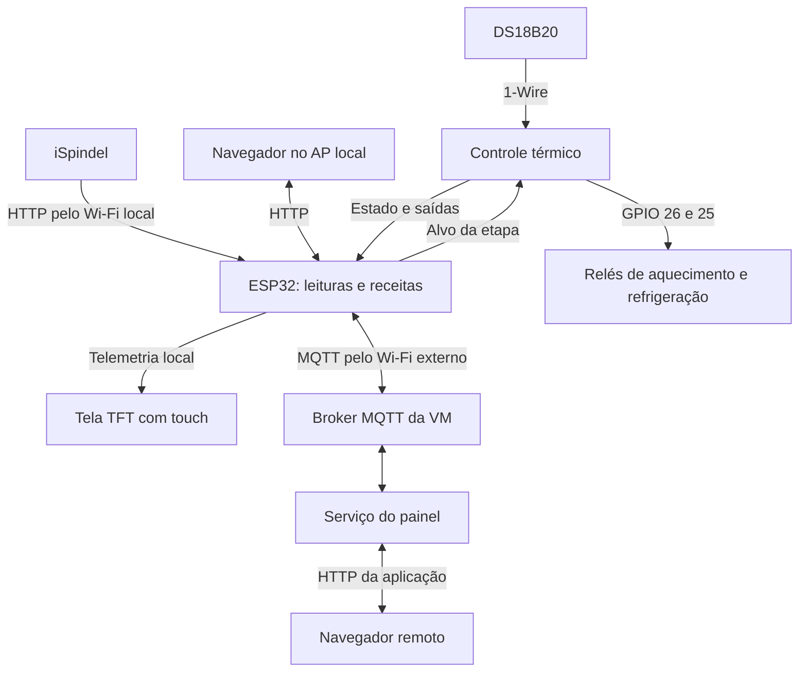

# Beer Fermentation Control

Controlador de fermentação para ESP32 DevKit V1 de 30 pinos. O operador define uma receita por etapas. O ESP32 mede a temperatura com um DS18B20, aciona aquecimento ou refrigeração e usa a densidade recebida do iSpindel para decidir quando avançar a receita. A tela e o portal local funcionam durante uma queda de internet. A VM permite acompanhar o processo e enviar comandos de fora da rede do fermentador.

## Arquitetura



O ESP32 cria o ponto de acesso (AP) do fermentador. O iSpindel e o celular entram nessa rede. Em paralelo, a interface estação (STA) do ESP32 conecta-se ao roteador de 2,4 GHz para alcançar a VM. As duas interfaces compartilham o rádio e passam a usar o canal do roteador. Quem autentica no broker é o ESP32. O iSpindel precisa alcançar apenas o endereço local do ESP32.

As tarefas FreeRTOS compartilham as últimas leituras por filas. O receptor HTTP pode atualizar a densidade enquanto o controlador continua verificando o DS18B20. A tarefa de receita altera a temperatura alvo. A tarefa de controle é a única responsável pelos GPIOs dos relés. Na partida, o firmware inicializa as saídas desligadas, lê as configurações da memória não volátil (NVS) e restaura a receita antes de iniciar a atuação térmica. [Inicialização](main/main.c)

## Hardware e pinagem

| Componente | Sinal | Ligação no ESP32 |
|---|---|---|
| DS18B20 local | DQ | GPIO13, com pull-up externo de 4,7 kΩ para 3V3. VDD em 3V3 e GND comum |
| RTC do protótipo, módulo HW-084 | SDA / SCL | GPIO5 / GPIO15, com pull-ups para 3V3. Endereço I²C `0x68` |
| Relé de aquecimento, J4 | IN | GPIO26, ativo em nível alto |
| Relé de resfriamento, J5 | IN | GPIO25, ativo em nível alto |
| TFT MAR2406, controlador ILI9341 | LCD_D0 a LCD_D7 | GPIO22, 23, 4, 16, 17, 18, 19 e 21, respectivamente |
| TFT | WR / RS / CS / RST | GPIO14 / GPIO32 / GPIO33 / GPIO27 |
| TFT | RD | 3V3 para operação de escrita |
| Touch resistivo | XP / YM / XM / YP | GPIO22 / GPIO23 / GPIO32 / GPIO33, compartilhados com D0 / D1 / RS / CS |

O driver mantém WR em nível alto durante a leitura do toque, mede os eixos com o ADC1 e devolve os pinos ao display antes da próxima escrita. A calibração e a associação entre os eletrodos e os pinos estão em [Mar2406Config.h](main/Mar2406Config.h). O RTC do protótipo tem marcação DS3231M e o nome usado no log é DS3232M. Confira a alimentação e a ordem dos terminais na revisão física de cada módulo. A lógica dos relés e os pinos do RTC estão em [RelayConfig.h](main/RelayConfig.h) e [RtcConfig.h](main/RtcConfig.h).

### Montagem do protótipo

A proposta de PCB coloca a tela na frente, a eletrônica no verso e os conectores nas bordas. A antena do ESP32 fica junto à borda superior, fora da projeção do display. Confira a folga da tela e a altura do módulo de relés no conjunto placa e caixa. As ligações da tabela descrevem o firmware desta branch.

Para a primeira verificação em bancada, mantenha as cargas desconectadas e observe os indicadores dos módulos. Compare a leitura do DS18B20 com a TFT, verifique se uma falha do sensor desliga os dois comandos e observe a contagem de espera antes de uma nova partida do compressor.

## Controle térmico e receitas

O DS18B20 fornece uma amostra a cada 2 s. A cada 500 ms o controlador compara a amostra local com o alvo. Por padrão, um alvo de 18 °C com diferenciais de 0,50 °C pede aquecimento a 17,50 °C ou menos e refrigeração a 18,50 °C ou mais. Ao atingir o alvo, o aquecimento desliga. A refrigeração também precisa cumprir o tempo mínimo ligada. A temperatura do iSpindel é uma segunda medição para monitoramento e comparação.

| Proteção | Padrão do firmware |
|---|---|
| Tempo mínimo do compressor ligado / desligado | 300 s em cada condição. O bloqueio de partida também vale após reiniciar |
| Troca entre aquecer e resfriar | 30 s com ambas as saídas desligadas |
| Amostra local inválida, fora da faixa ou vencida | Desliga ambas as saídas. Validade padrão de 5 s e faixa de −5 a 40 °C |
| Cancelamento da receita | Desabilita o controle e solicita o desligamento de ambas as saídas |

Uma receita JSON v1 contém de 1 a 16 etapas. Cada etapa tem nome, temperatura alvo (`target_c`), prazo máximo em dias (`max_days`) e um limite opcional de densidade (`gravity_limit`). A tarefa verifica o progresso a cada segundo. A etapa termina quando vence o prazo **ou** quando a densidade atinge o limite em leituras consecutivas. Por padrão são três leituras novas, na unidade da receita (`sg` ou `plato`). Se o iSpindel ficar indisponível, o prazo continua valendo.

Na receita de exemplo, a primeira etapa mantém 20 °C por até cinco dias. Três leituras consecutivas de SG ≤ 1,020 encerram essa etapa antes do prazo. A próxima etapa passa a contar seu próprio tempo. Ao concluir a última, o sistema mantém o último alvo. Para substituir uma receita em execução, cancele-a primeiro. [Exemplo completo](recipes/exemplo.json) · [Esquema JSON](recipes/recipe.schema.json)

A NVS guarda a receita e o progresso no início, nas transições, no cancelamento e a cada 15 minutos de execução. Após uma queda de energia, a contagem retoma do último registro salvo e considera apenas o tempo em que o ESP32 esteve ligado. Alterações de histerese e da rede externa também são persistidas. O RTC fornece a hora local para a tela e os logs. Com rede externa, o ESP32 sincroniza por SNTP e ajusta o RTC para o horário de Brasília (UTC−3). A duração das etapas usa um relógio monotônico independente do RTC.

## Compilar, gravar e configurar

O projeto usa C, ESP-IDF e o alvo `esp32`. O manifesto aceita ESP-IDF ≥ 5.0, e a resolução registrada usa **ESP-IDF 6.0.0 e LVGL 9.3.0**. O gerenciador de componentes resolve também OneWire, DS18B20, cJSON e o cliente MQTT. A tabela de partições reserva espaço para NVS, dados de rádio e a aplicação `factory`. [Dependências](main/idf_component.yml) · [Configurações padrão](sdkconfig.defaults) · [Partições](partitions.csv)

1. Abra um terminal ESP-IDF na raiz do repositório. Em um clone novo, execute `idf.py set-target esp32`. Em uma instalação já configurada para esse alvo, prossiga direto para `menuconfig` para preservar a configuração local.
2. Execute `idf.py menuconfig` e ajuste os menus abaixo. As senhas reais ficam no `sdkconfig` local, fora do Git.
3. Execute `idf.py build`. Com a placa conectada, use `idf.py -p COM6 flash monitor`, substituindo `COM6` pela porta do ESP32.

| Menu em `menuconfig` | O que configurar |
|---|---|
| Beer Monitor - Wi-Fi and iSpindel | SSID, senha e IP do AP, validade da leitura do iSpindel e suporte à rede externa. Use sub-redes diferentes para AP e roteador |
| Beer Monitor - Temperature control | Alvo inicial, diferenciais, limites de temperatura e tempos do compressor |
| Beer Monitor - Local recipe interface | Portal cativo e senha da interface. Com o campo vazio, a interface usa a senha do AP |
| Beer Monitor - Fermentation recipe | Início opcional da receita incorporada quando ainda não há execução salva. Desabilitado por padrão |
| Beer Monitor - MQTT broker | Habilitação, URI, identificador e senha MQTT do dispositivo e intervalo de telemetria |

## Operação no fermentador

**Portal local.** Conecte o celular ou computador ao AP `BeerMonitor` (nome padrão) e abra a página oferecida pelo portal cativo ou acesse [192.168.50.1](http://192.168.50.1/). Entre com a senha local. A página permite importar ou exportar a receita JSON, editar e ordenar etapas, iniciar, cancelar, pular a etapa atual, ajustar a histerese e configurar o Wi-Fi externo. Depois de salvar o Wi-Fi, acompanhe a conexão na TFT. O acesso direto pelo IP funciona mesmo quando o celular não abre o portal automaticamente.

| API local | Finalidade |
|---|---|
| `GET /api/status` | Leituras, estado do controle, andamento da receita e configurações |
| `GET /api/recipe` · `POST /api/recipe` | Consultar a receita ou enviar uma para início |
| `POST /api/recipe/cancel` · `POST /api/recipe/skip` | Cancelar ou avançar a etapa indicada pelo campo `step`, contado a partir de 1 |
| `POST /api/settings/hysteresis` · `POST /api/settings/wifi` | Salvar diferenciais térmicos ou credenciais da rede externa |

O servidor atende clientes do AP. A página envia a chave de acesso como bytes UTF-8 codificados em hexadecimal no cabeçalho `X-Local-Key`. As requisições que alteram o estado também exigem a origem HTTP do próprio AP. Para operações de receita enfileiradas, HTTP 202 indica aceitação do pedido. Consulte `/api/status` para acompanhar a execução. [Página embarcada](main/web/index.html) · [API HTTP](main/LocalWebUi.c)

**Tela.** As setas do touch alternam entre cinco páginas em 320 × 240 pixels. *Temperatura* mostra DS18B20, alvo e atuação dos relés. *Receita* mostra a etapa e seu progresso. *Densidade* e *iSpindel* exibem as medições do sensor flutuante. *Sistema* mostra a hora local. O cabeçalho informa a conexão ao Wi-Fi externo. [Interface LVGL](main/DisplayTest.c)

**Entrada do iSpindel.** Configure o transmissor para entrar no AP e enviar `POST /ispindel` na porta 80 com `Content-Type: application/json`. O receptor espera o formato abaixo, com até 511 bytes. `gravity_unit` vale 0 para desconhecida, 1 para SG e 2 para Plato.

```json
{"version":1,"sensor_id":101,"boot_id":7,"sequence":1,"gravity_unit":1,"temperature_c":19.8,"tilt_degrees":42.1,"gravity":1.018,"battery_v":3.94}
```

Uma leitura aceita recebe HTTP 200 com `accepted: true` e os mesmos `sensor_id`, `boot_id` e `sequence`. Reenviar a última leitura idêntica recupera a confirmação sem contar outra amostra. O intervalo de envio é ajustado no transmissor. Configure a validade no ESP32 acima desse intervalo, com margem. O padrão desta branch é **600 s**. [Receptor HTTP](main/IspindelReceiver.c) · [Validação do JSON](main/BrewJson.c)

## MQTT entre o ESP32 e a VM

O navegador remoto acessa o painel web. O serviço do painel troca mensagens com o broker para obter as leituras e solicitar ações ao ESP32. Do lado do dispositivo, uma única conexão MQTT 3.1.1 atende os dois sentidos. A receita e o controle térmico continuam executando no ESP32 quando essa conexão cai. As amostras permanecem disponíveis localmente, mas o firmware não mantém um histórico persistente para reenviar todo o período offline.

### Conexão e tópicos

Habilite o Wi-Fi externo e o MQTT. Configure a URI do broker, por exemplo `wss://HOST_DA_VM/mqtt` quando o proxy oferece WebSocket nesse caminho, ou `mqtts://HOST_DO_BROKER:8883` quando há um listener TLS nessa porta. Use o endereço e o certificado correspondentes à implantação. O usuário MQTT é o próprio identificador do fermentador (`fermentador01` por padrão). A senha é a credencial desse dispositivo no broker. O login do painel, a chave SSH da VM e a senha do AP têm outras funções.

Após obter conexão externa, o cliente autentica, assina o tópico de comandos com QoS 1 e aguarda a confirmação da assinatura para anunciar o estado. Todos os tópicos abaixo usam o prefixo `cervejaria/v1/fermentadores/<dispositivo>`.

| Sufixo | Quem publica → quem recebe | Conteúdo e entrega |
|---|---|---|
| `/telemetria` | ESP32 → serviço de coleta da VM | Leituras e progresso. QoS 1, sem retenção, a cada 15 s por padrão |
| `/estado/receita` | ESP32 → backend do painel | `kind: state` a cada 3 s, QoS 0. `kind: result` confirma uma solicitação, QoS 1. Ambos sem retenção |
| `/comandos/receita` | Backend do painel → ESP32 | Pedido de operação enviado sem retenção. O firmware descarta comandos retidos |

Na telemetria, `temperatura-local` vem do DS18B20. `densidade` contém `value` e um `context` com unidade e sensor. O iSpindel fornece também `temperatura-ispindel`, `inclinacao` e `bateria`. `temperatura-alvo`, `estado-controle`, `etapa-fermentacao`, `dias-etapa` e `dias-max-etapa` descrevem a atuação e a receita. O firmware omite os grupos cuja fonte está inválida ou vencida. Quando há hora de sistema válida, inclui `timestamp` em UTC.

### Como o painel solicita uma operação

1. O backend lê a última mensagem `kind: state`. Ela contém `session`, `lease` e `revision`, além da receita, etapa, histerese, SSID conectado e indicação `uplink_configurable`.
2. Ao receber uma ação do operador, o backend publica `id` (UUID em minúsculas), `action` e os três campos obtidos do estado. `lease` é a contagem de segundos de funcionamento do ESP32 anunciada por ele. A janela de validade é de 12 s. Cada reconexão MQTT gera uma nova sessão.
3. O ESP32 verifica a sessão, a validade, a revisão e os dados da ação. Comandos retidos, expirados ou com ID repetido podem ser descartados sem resposta. Um comando aceito pelo broker ainda precisa ser processado no dispositivo.
4. O painel correlaciona `kind: result` pelo mesmo `id` e lê `outcome` (`applied` ou `rejected`), `code` e `storage_ok`. No cancelamento bem-sucedido, o ESP32 espera o controlador confirmar as duas saídas desligadas.

| `action` | Dados além do envelope | Efeito |
|---|---|---|
| `start` | `recipe` como objeto JSON v1 | Valida a receita e solicita o início |
| `cancel` | Nenhum | Cancela a execução e desabilita o controle |
| `skip` | `step`, número da etapa atual a partir de 1 | Avança a etapa informada se ela ainda estiver ativa |
| `hysteresis` | `heating_centic` e `cooling_centic`, inteiros de 10 a 500 | Ajusta os diferenciais. O valor 50 equivale a 0,50 °C |
| `wifi` | `ssid`, `password`, `username` e `identity` como texto. Use `""` nos campos não utilizados | Salva a rede externa para reconexão. Requer `wss://` ou `mqtts://` |

Por exemplo, ao clicar em *Pular etapa* durante a etapa 2, o painel envia `action: "skip"` e `step: 2` com os identificadores do estado recente. Se a receita já avançou por densidade, a verificação da etapa e da revisão impede um segundo avanço. A limpeza do histórico do painel pertence à aplicação da VM. O protocolo desta branch implementa as cinco ações da tabela. [Implementação da comunicação MQTT](main/BrokerMqtt.c)

### Conferir a comunicação

| O que se observa | Como localizar o problema |
|---|---|
| O portal local funciona e o painel remoto não atualiza | Confira o Wi-Fi externo na TFT. No monitor serial, procure `MQTT conectado`. Se faltar, confira URI, acesso da rede ao broker e credencial do dispositivo |
| Há telemetria, mas o painel não habilita os comandos | Procure `Assinatura confirmada` no monitor e `kind: state` no backend. Confira o mesmo identificador e as permissões de publicar e assinar nos três tópicos |
| O clique no painel fica sem confirmação | Compare o `id` do pedido com o do resultado, confira a idade de `lease`, a sessão e a revisão. Atualize o estado antes de decidir sobre uma nova solicitação |
| O Wi-Fi foi alterado e o fermentador sumiu do painel | A confirmação informa que as credenciais foram salvas. Verifique se o novo SSID alcança a VM ou corrija a rede pelo portal do AP |
| O painel recebe a temperatura local, mas falta densidade | Confira o `POST /ispindel` no AP, a unidade da receita e o tempo desde a última leitura aceita |

Na implantação do projeto, o painel foi identificado em `/opt/fermentacao/app` na VM, com backend Node.js/TypeScript, contêiner `fermentacao-painel-1` e porta HTTP interna padrão 8090. A consulta `GET /api/recipe?device=fermentador01` é um ponto de verificação do estado visto pelo painel. A porta HTTP do painel e a URI MQTT do ESP32 atendem protocolos distintos. O código do backend e a configuração de implantação são mantidos fora desta branch. Os nomes da implantação servem de referência para quem estiver operando a VM.

## Mapa do código

| Área | Arquivos |
|---|---|
| Inicialização, componentes e opções de compilação | [main.c](main/main.c), [CMakeLists.txt](main/CMakeLists.txt), [Kconfig.projbuild](main/Kconfig.projbuild) |
| Wi-Fi, portal e DNS local | [WifiStation.c](main/WifiStation.c), [CaptivePortal.c](main/CaptivePortal.c), [CaptiveDns.c](main/CaptiveDns.c) |
| Sensores e logs seriais | [LocalTemperature.c](main/LocalTemperature.c), [IspindelReceiver.c](main/IspindelReceiver.c), [BrewProtocol.h](main/BrewProtocol.h), [BrewJson.c](main/BrewJson.c), [TelemetryLogger.c](main/TelemetryLogger.c) |
| Controle e proteção dos atuadores | [TemperatureControl.c](main/TemperatureControl.c), [TemperatureControlLogic.c](main/TemperatureControlLogic.c) |
| Receita, persistência, transições e validação | [FermentationRecipe.c](main/FermentationRecipe.c), [FermentationRecipeLogic.c](main/FermentationRecipeLogic.c), [FermentationRecipeJson.c](main/FermentationRecipeJson.c) |
| Relógio, TFT e toque | [RtcClock.c](main/RtcClock.c), [DisplayTest.c](main/DisplayTest.c), [Mar2406Display.c](main/Mar2406Display.c), [Mar2406Touch.c](main/Mar2406Touch.c) |
| Interfaces de operação | [LocalWebUi.c](main/LocalWebUi.c), [index.html](main/web/index.html), [BrokerMqtt.c](main/BrokerMqtt.c) |
