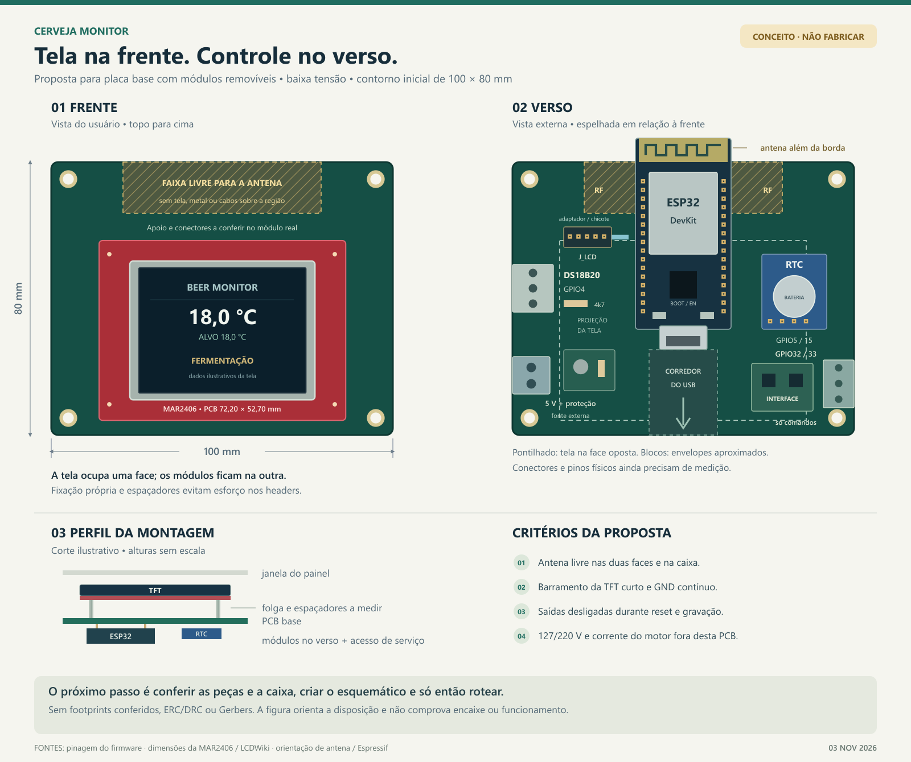

# Cerveja Monitor 🍺

Monitor e controlador de fermentação com **ESP32, ESP-IDF e FreeRTOS**. Mede a
temperatura com um DS18B20 local, recebe a telemetria de um iSpindel e comanda
aquecimento e refrigeração por histerese. O operador configura receitas pelo
navegador, acompanha os dados na tela e pode enviá-los ao Ubidots.

## Funcionamento

```text
DS18B20 ──────────────> controle local ──────> comandos de aquecer / resfriar
                              ↑                         ↓
iSpindel ── Wi-Fi/HTTP ──> ESP32 + receitas      interface / potência externa
                              │
                 ┌────────────┼─────────────┐
              TFT + RTC   navegador     Wi-Fi externo
                          no AP local        └── MQTT → Ubidots
```

- **Controle independente da internet:** usa o DS18B20 local como realimentação.
  A temperatura do iSpindel é exibida e publicada, mas não comanda os relés.
- **Proteções no firmware:** desliga os comandos quando o sensor falha ou a
  amostra vence, impede aquecimento e refrigeração simultâneos e aplica tempos
  de espera para o compressor e para a troca de modo.
- **Receitas:** até 16 etapas com temperatura alvo, prazo máximo e limite opcional
  de densidade; receita e progresso são persistidos em NVS. Uma receita ativa
  salva pode retomar após reiniciar.
- **Interface local:** rede Wi-Fi própria, portal cativo e editor de receitas
  no navegador. Não precisa de aplicativo instalado.
- **Monitoramento:** TFT MAR2406/ILI9341, RTC e telemetria MQTT opcional.
  O enlace atual com o iSpindel usa HTTP/JSON por Wi-Fi.

## Hardware e pinagem atual

Base: ESP32 clássico, DS18B20 alimentado em 3,3 V, display MAR2406 paralelo
de 8 bits, RTC compatível com o driver DS3232M e interface para dois comandos
de relé. Confira o modelo e a pinagem dos módulos físicos antes de montar.

| Função | ESP32 / conexão |
|---|---|
| DS18B20 — DQ | GPIO4, pull-up externo de 4,7 kΩ para 3,3 V |
| Aquecimento | GPIO32, comando ativo em LOW |
| Refrigeração | GPIO33, comando ativo em LOW |
| RTC — SDA / SCL | GPIO5 / GPIO15; pull-ups para 3,3 V |
| TFT — D0…D7 | GPIO13, 14, 16, 17, 18, 19, 21, 22 |
| TFT — WR / RS / CS / RST | GPIO23 / GPIO25 / GPIO26 / GPIO27 |
| TFT — RD | 3,3 V; interface somente de escrita |

A alimentação da tela deve seguir a revisão real do módulo e o guia
[TESTE_MAR2406.md](TESTE_MAR2406.md). GPIOs não recebem 5 V. Os GPIO5 e GPIO15
também são pinos de configuração de partida: valide o boot com o RTC conectado.

**Os GPIOs são comandos, não saídas de potência.** A corrente nominal resistiva
impressa em um módulo de relés não basta para selecionar o acionamento de um
compressor. A etapa de potência deve ser dimensionada para o motor e montada
com proteção, isolamento e aterramento adequados. O desenho abaixo propõe uma
placa de controle de baixa tensão alimentada por fonte USB externa, com a
potência separada.

## Preparar, compilar e gravar

Use um ambiente ESP-IDF configurado para o ESP32 clássico. O manifesto declara
ESP-IDF `>=5.0.0`, e o arquivo `dependencies.lock` registra uma resolução com
`6.1.0`; isso não comprova compatibilidade com todas as versões intermediárias.
As dependências incluem OneWire, DS18B20, cJSON e MQTT, conforme
[main/idf_component.yml](main/idf_component.yml).

No terminal ESP-IDF, a partir da raiz do repositório:

```powershell
idf.py set-target esp32
idf.py menuconfig
idf.py build
idf.py -p COMx flash monitor
```

Substitua `COMx` pela porta do dispositivo. Em uma instalação já configurada,
preserve o `sdkconfig` antes de executar `set-target`, que pode redefinir a
configuração. O arquivo [sdkconfig.defaults](sdkconfig.defaults) seleciona a
tabela de partições de [partitions.csv](partitions.csv).

Configure em `menuconfig`:

| Menu | Configuração |
|---|---|
| Beer Monitor - Wi-Fi and iSpindel | AP local, senha, rede externa opcional e validade da telemetria |
| Beer Monitor - Temperature control | Alvo, histerese, limites e tempos de proteção |
| Beer Monitor - Local recipe interface | Senha da página local e portal cativo |
| Beer Monitor - Fermentation recipe | Opção de iniciar a receita de exemplo; desabilitada por padrão |
| Beer Monitor - Ubidots STEM | Token, identificação do dispositivo e intervalo de envio |

Troque a senha de exemplo do AP. Não publique senhas, tokens ou um `sdkconfig`
com credenciais. A publicação atual usa MQTT/TCP sem TLS, conforme
[UBIDOTS.md](UBIDOTS.md); considere essa limitação ao escolher a rede.

## Usar a interface local

1. Conecte ao AP do ESP32, chamado `BeerMonitor` por padrão.
2. Abra o portal oferecido pelo aparelho ou acesse **http://192.168.50.1/**.
3. Entre com a senha local; se nenhuma senha específica foi configurada, use
   a senha do AP.
4. Cadastre as etapas e selecione **Salvar e iniciar receita**.

O endereço pode mudar conforme a configuração do AP. Para substituir uma
receita em execução, cancele-a pela interface primeiro. Ao terminar a última
etapa, o firmware mantém sua temperatura alvo. Consulte
[INTERFACE_LOCAL.md](INTERFACE_LOCAL.md) e [RECEITAS.md](RECEITAS.md).

## Proposta de PCB



Tela na frente, eletrônica no verso e conectores nas bordas. A antena do ESP32
fica junto à borda superior, fora da projeção da tela. Dimensões, módulos e
conectores ainda precisam de conferência mecânica; **a figura não é um layout
roteado nem um arquivo pronto para fabricação**.

Veja as decisões e pendências em
[hardware/pcb/DISPOSICAO.md](hardware/pcb/DISPOSICAO.md) e o
[desenho vetorial](hardware/pcb/disposicao_pcb.svg).

## Organização e documentação

| Caminho | Conteúdo |
|---|---|
| [main/](main/) | Firmware C, configuração dos GPIOs e página web embarcada |
| [recipes/](recipes/) | Receita de exemplo e esquema JSON |
| [tests/](tests/) | Testes no computador e prévia da interface |
| [CONTROLE.md](CONTROLE.md) | Controle térmico, estados e proteções |
| [RECEITAS.md](RECEITAS.md) | Contrato JSON e execução das receitas |
| [INTERFACE_LOCAL.md](INTERFACE_LOCAL.md) | Configuração pelo navegador e API local |
| [UBIDOTS.md](UBIDOTS.md) | Wi-Fi, iSpindel, RTC e envio de dados |
| [TESTE_MAR2406.md](TESTE_MAR2406.md) | Ligação e teste do display |
| [hardware/pcb/DISPOSICAO.md](hardware/pcb/DISPOSICAO.md) | Proposta mecânica da placa de controle |

## Validação

Os testes existentes exigem Python 3; os que compilam código C também precisam
de GCC disponível. Exemplos, na raiz do projeto:

```powershell
python tests/test_temperature_control.py
python tests/test_fermentation_recipe.py
python tests/test_rtc_clock.py
python tests/test_local_web_ui.py
python tests/test_control_telemetry.py
```

Esses testes verificam comportamentos com simulações no computador. Não
substituem compilação para o ESP32, ensaios elétricos, verificação do rádio ou
validação térmica. Antes de conectar cargas, confira a polaridade real dos
comandos, falha do sensor, partida, reset e bloqueio do compressor em bancada.
