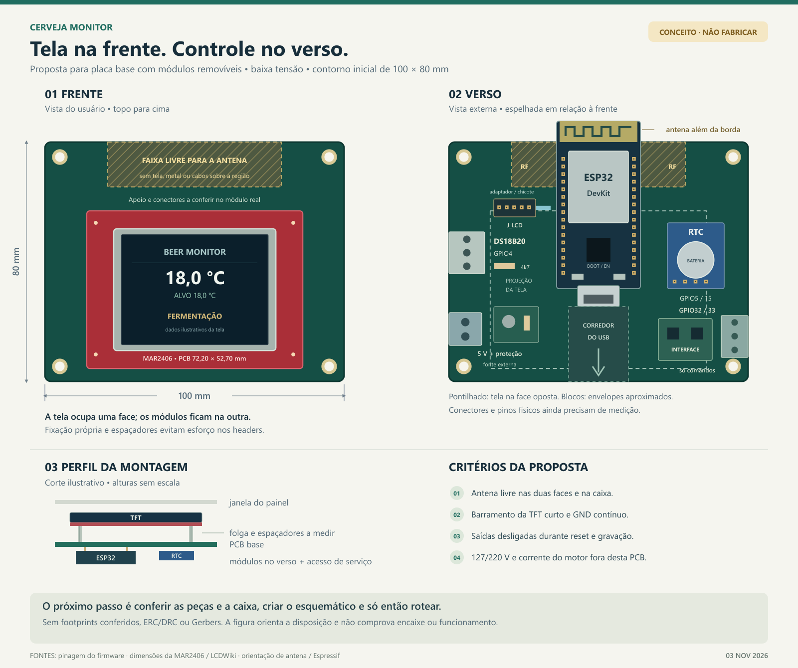

# Disposição proposta para a PCB

[Abrir o desenho vetorial](disposicao_pcb.svg).

## Decisão de montagem

Para a primeira versão, a proposta é uma **placa base para módulos**, com a
MAR2406 voltada ao usuário e ESP32, RTC e interfaces no verso. Isso mantém os
módulos substituíveis e aproveita o firmware existente. A tela deve ter apoio
mecânico próprio; os conectores não devem sustentar sozinhos a montagem.

O contorno de **100 × 80 mm** é uma hipótese inicial, baseada no contorno do
arquivo Eagle local existente, ainda sem circuito. O fabricante informa
**72,20 × 52,70 mm** para a PCB da MAR2406. O espaço restante sugere viabilidade,
mas não comprova o encaixe: faltam medidas dos módulos, conectores, caixa e
alturas. Os corpos desenhados são envelopes aproximados, não footprints.

Frente e verso são vistos de fora. O verso foi espelhado horizontalmente em
relação à frente: a borda esquerda da vista traseira corresponde à borda direita
da vista frontal. O topo continua sendo o mesmo. Linhas pontilhadas indicam a
projeção da tela na face oposta; não são trilhas elétricas.

## Posição dos conjuntos

| Conjunto | Posição sugerida | Motivo |
|---|---|---|
| TFT MAR2406 | Frente, abaixo da faixa reservada ao rádio | Permite janela no painel e evita sobrepor a tela à antena |
| ESP32 DevKit | Verso, com antena junto à borda superior e preferencialmente além do contorno | Reduz obstrução pelo display e facilita substituir o módulo |
| Conexão da TFT | Verso, perto do ESP32 e alinhada aos conectores reais da tela | Mantém curto o barramento paralelo; pode exigir adaptador ou chicote curto |
| RTC e bateria | Lateral do verso, longe da antena e da interface dos relés | Permite manutenção da bateria e conexão I²C curta |
| DS18B20 | Conector na borda, com pull-up de 4,7 kΩ próximo | Facilita levar o cabo para a câmara e identificar 3V3, GND e DQ |
| Alimentação | Borda inferior/lateral, com proteção e desacoplamento próximos | Evita atravessar a placa com o cabo de entrada |
| Interface dos comandos | Próxima ao conector para a etapa externa | Mantém o caminho das saídas curto e afasta a comutação do sensor |
| USB do DevKit | Corredor livre para encaixe do plugue e acesso pela caixa | Permite gravar e depurar sem desmontar a tela |
| Fixação | Próxima aos cantos, ajustada à caixa | Sustenta a PCB; apoio da tela deve respeitar seus pontos reais de montagem |

O desenho não representa posições físicas de pinos do DevKit ou do shield.
Use os nomes dos sinais do firmware e confira a ordem de cada conector antes
de criar o esquemático. Não suponha que os headers da MAR2406 formem uma única
barra com passo uniforme; confirme os offsets do shield Arduino na placa real.

## Antena e tela em faces opostas

A face metálica da tela, sua placa, a bateria do RTC, cabos e a caixa também
influenciam o rádio. Por isso, colocar a antena diretamente atrás da tela é uma
má escolha inicial. Reserve uma faixa no topo e mantenha a região da antena
livre nas duas faces e no conjunto mecânico.

A Espressif recomenda preferir a antena do módulo fora da placa base. Quando
isso não for possível, seu guia pede ao menos **15 mm ao redor da área da
antena**, sem cobre, trilhas ou componentes. O afastamento exato deve seguir o
módulo escolhido; essa recomendação não é uma distância de isolamento de rede
elétrica. O desenho marca uma reserva conceitual, cujo tamanho final depende
do DevKit real e de sua posição.

Fonte: [Espressif — posicionamento de módulos e antena](https://docs.espressif.com/projects/esp-hardware-design-guidelines/en/latest/esp32/pcb-layout-design.html#general-principles-of-pcb-layout-for-modules-positioning-a-module-on-a-base-board).

## Alimentação, sinais e comandos

- Use fonte externa de baixa tensão; dimensione 5 V e 3,3 V pela corrente real
  do conjunto, inclusive tela e eventuais módulos. Não pressuponha que o
  regulador do DevKit possa alimentar tudo.
- Defina um caminho de alimentação que impeça retorno entre a fonte externa
  e o USB de programação. A solução depende do esquema do DevKit escolhido;
  não una duas fontes de 5 V sem verificar esse caminho.
- A PCB proposta contém somente alimentação de baixa tensão e comandos.
  Relés de potência, contatores, fusíveis e bornes de 127/220 V ficam em
  conjunto separado. O conector de comandos não transporta a corrente do motor.
- Não ligue bobinas diretamente aos GPIOs. Se houver bobina na interface,
  dimensione driver e supressão; se for módulo pronto, confirme alimentação,
  corrente e compatibilidade de entrada com 3,3 V.
- Preserve GPIO32/33 e a polaridade ativa em LOW do firmware. Projete a
  interface para permanecer desligada durante reset, programação e ausência
  do ESP32. A validação inclui alimentação do módulo de comando com o ESP32
  desligado; não basta confiar na inicialização por software.
- Mantenha retorno de alimentação da interface de comandos longe do caminho
  do sensor. Use referência de GND contínua para os sinais de baixa tensão,
  respeitando a reserva de antena; evite cortes sob o barramento da tela.
- Mantenha o barramento paralelo da TFT curto, com retorno de GND próximo,
  sem roteá-lo na área de antena. Valores de resistores série, proteção e
  desacoplamento dependem do esquema e da verificação elétrica.
- O RTC usa GPIO5/15, ambos com função de configuração de partida. Verifique
  os pull-ups existentes no módulo, sua tensão e o comportamento no reset.
  Sinais I²C do ESP32 devem permanecer em 3,3 V.
- Preveja pontos de teste para GND, 5 V, 3,3 V, DQ e os dois comandos,
  além de acesso a BOOT/EN. Se o módulo RTC tiver circuito de carga, confirme
  que a bateria escolhida é compatível.

A MAR2406 documentada usa ILI9341 e interface paralela de 8 bits. Revise o
esquema da revisão física antes de definir sua alimentação; as etiquetas 5V e
3V3 não autorizam aplicar 5 V aos GPIOs.
Fonte: [LCDWiki — MAR2406](https://www.lcdwiki.com/2.4inch_Arduino_Display).
A pinagem utilizada está em [TESTE_MAR2406.md](../../TESTE_MAR2406.md).

## Perfil mecânico

Na direção frente → fundo: janela da caixa, módulo TFT, espaço para os
conectores/isolamento mecânico, PCB base, módulos do verso e tampa traseira.
Defina espaçadores pela maior altura real sob a tela, incluindo soldas e
conectores; não adote uma altura padrão sem medir. Reserve espaço para o
plugue USB e para tirar a bateria do RTC. Partes metálicas da tela não podem
encostar em terminais ou soldas da outra montagem.

## Antes de fabricar

1. Confirmar o DevKit exato: largura entre headers, quantidade de pinos,
   orientação da antena, USB, regulador e circuito de alimentação.
2. Medir a MAR2406 real: contorno, offsets dos headers, área visível, pontos
   de apoio e maior altura na face inferior. Fazer gabarito em escala 1:1.
3. Escolher RTC, conectores, interface dos comandos, fonte e caixa; conferir
   tensões, correntes, polaridade e espaço de manutenção.
4. Criar o esquemático e a lista de conexões; revisar partida e saídas desligadas.
5. Transferir os footprints conferidos para o layout e verificar interferências
   dos dois lados, incluindo a projeção da tela e a área livre da antena.
6. Rotear a placa, aplicar as regras da fabricante e executar ERC/DRC.
7. Validar o protótipo de baixa tensão, resets e Wi-Fi com tela e caixa montadas.
   A etapa de potência exige dimensionamento e revisão próprios.

**Estado desta entrega:** proposta visual de disposição. Não há esquemático
elétrico completo, roteamento, ERC/DRC, Gerbers ou comprovação de encaixe e
funcionamento físico associados a esta figura.
